  

# Awesome Team File Storage & Content Collaboration 📁 ☁️ 🚀

  
  
  
  
  

> 🌟 A curated directory and architectural comparison guide to premier **Team File Storage**, **Content Collaboration**, and **Enterprise File Sync & Share (EFSS)** platforms — featuring commercial cloud SaaS suites and self-hosted open-source solutions for shared cloud drives, secure multi-device synchronization, granular access governance, zero-knowledge encryption, and collaborative document editing. 🚀
>
> ⭐ *Star this repository if you find it helpful!* ⭐

---

## 📋 Table of Contents

- [🌐 Sector Overview & Market Dynamics](#-sector-overview--market-dynamics)
- [🟦 SaaS / Hosted Platforms](#-saas--hosted-platforms)
- [🟩 Open-Source Software](#-open-source-software)
- [📊 Comparison at a Glance](#-comparison-at-a-glance)
- [💖 Support](#-support)
- [📈 Star History](#-star-history)
- [🤝 Contributing](#-contributing)
- [📄 License](#-license)

---

## 🌐 Sector Overview & Market Dynamics

The global Content Collaboration Platforms (CCP) and Enterprise File Sync and Share (EFSS) market is valued at approximately **$12.5 billion** and is projected to expand beyond **$32 billion by 2030** (CAGR ~17%). The industry exhibits a **concentrated, oligopolistic top tier** dominated by hyperscalers (Microsoft and Google) who bundle storage natively into workplace productivity suites, while specialized standalone vendors (Dropbox, Box, Egnyte) defend regulated enterprise and hybrid niches, leaving a thriving open-source ecosystem for organizations demanding on-premises data sovereignty and strict compliance. 💼 🔒

---

## 🟦 SaaS / Hosted Platforms

Commercial, cloud-hosted enterprise file storage and content collaboration platforms. Sorted descending by company scale (market capitalization / valuation / annual revenue). 🏢 📊

| Platform | Starting Tier Pricing | Free Tier / Free Trial Limits | Company Scale (Valuation / Revenue) | Real-Time Co-Editing | Key Strengths & Trade-offs |
|:---|:---|:---|:---|:---|:---|
| **[Microsoft OneDrive & SharePoint](https://www.microsoft.com/en-us/microsoft-365/onedrive/online-cloud-storage)** | **$5.00** /user/month (OneDrive for Business Plan 1, annual billing) | **5 GB** free forever (personal account); **30-day free trial** for Microsoft 365 Business (up to 25 licenses with 1 TB/user) | **~$3.1 Trillion** market cap (Microsoft Corp, $245B+ annual revenue) | ✅ Native Microsoft 365 Office web/desktop co-authoring | **Pros:** Default enterprise standard; native Windows Files On-Demand and SharePoint team sites. **Trade-off:** SharePoint administration and permission governance are notoriously complex. |
| **[Google Drive (Google Workspace)](https://workspace.google.com/products/drive/)** | **$6.00** /user/month (Business Starter, 1-year commitment) | **15 GB** pooled free forever across Drive, Gmail, & Photos; **14-day free trial** for Google Workspace | **~$2.1 Trillion** market cap (Alphabet Inc, $350B+ annual revenue) | ✅ Native Google Docs, Sheets, Slides real-time collaboration | **Pros:** Gold standard for low-friction real-time co-authoring, Shared Drives, and lightning-fast search. **Trade-off:** Complex formatting in desktop Office files can degrade during conversion. |
| **[Dropbox Business](https://www.dropbox.com/business)** | **$9.00** /user/month (Dropbox Essentials, 1 user, billed annually) | **2 GB** free forever (Dropbox Basic); **30-day free trial** for Business Standard (up to 3+ users, 5 TB storage pool) | **~$8.5 Billion** market cap (Dropbox Inc, $2.5B+ annual revenue) | ⚠️ External integrations (Dropbox Paper / Office web) | **Pros:** Best-in-class, rock-solid block sync engine with selective sync and smart sync. **Trade-off:** Lacks comprehensive enterprise document lifecycle governance out of the box. |
| **[Box](https://www.box.com/)** | **$15.00** /user/month (Box Business, min 3 users, billed annually) | **10 GB** storage / 250 MB max file upload limit free forever; **14-day free trial** for Business & Enterprise tiers | **~$4.5 Billion** market cap (Box Inc, $1.04B+ annual revenue) | ⚠️ Box Notes native; integrations for MS 365 & Google | **Pros:** Enterprise-grade security certifications (FedRAMP High, HIPAA, FINRA, SOC 2) and 1,500+ integrations. **Trade-off:** Higher per-user cost; primarily a content and governance layer rather than workspace suite. |
| **[Zoho WorkDrive](https://www.zoho.com/workdrive/)** | **$2.50** /user/month (Starter tier, min 3 users, billed annually) | **5 GB** shared storage free forever (up to 3 users, 1 GB file upload limit); **15-day free trial** on Team plans | **~$1.4 Billion+** annual revenue (Zoho Corp, bootstrapped private valuation ~$10B–$15B) | ✅ Native Zoho Writer, Sheet, Show real-time co-editing | **Pros:** Unmatched cost-to-value ratio for small-to-medium teams already inside the Zoho ecosystem. **Trade-off:** Third-party app ecosystem and standalone brand presence are weaker than hyperscalers. |
| **[Egnyte](https://www.egnyte.com/)** | **$20.00** /user/month (Business plan, min 10 users, billed annually) | **15-day free trial** (unlimited access to collaborative hybrid storage & audit features, no credit card required) | **~$1.6 Billion** valuation (Private equity / pre-IPO, ~$250M+ ARR) | ⚠️ Microsoft Office 365 web co-editing integration | **Pros:** Premier hybrid deployment (cloud + local NAS/on-prem cache) with granular audit trails and DLP. **Trade-off:** High entry barrier (minimum seat thresholds) and steeper learning curve. |

---

## 🟩 Open-Source Software

Self-hosted, community-driven file sync, storage, and collaboration engines. Sorted descending by GitHub stargazers count with official white social badges linking directly to each repository's stargazers. 💻 🔓

| Project | GitHub_Stars | License | Primary Tech Stack | Architecture & Type | Description & Primary Use Case |
|:---|:---|:---|:---|:---|:---|
| **[Syncthing](https://github.com/syncthing/syncthing)** |  | MPL-2.0 | Go | Peer-to-Peer (Decentralized) | Open, decentralized peer-to-peer file synchronization engine that syncs files directly between devices over TLS/LAN without storing data on central third-party servers. Ideal for secure multi-node sync and private cross-machine backup. |
| **[Rclone](https://github.com/rclone/rclone)** |  | MIT | Go | Multi-Cloud Sync & Storage Mount CLI/Engine | The "Swiss Army knife of cloud storage" supporting over 70 cloud storage providers. Mounts remote cloud buckets (S3, Drive, OneDrive, WebDAV) as local drives, syncs directories, and provides bidirectional team data pipeline replication. |
| **[Nextcloud Server](https://github.com/nextcloud/server)** |  | AGPL-3.0 | PHP / MariaDB / Redis | Full Self-Hosted Productivity & Storage Suite | The definitive open-source Google Workspace / 365 replacement. Combines team file storage, desktop/mobile sync clients, collaborative document editing (Nextcloud Office / Collabora / OnlyOffice), groupware (Calendar, Mail, Contacts), and Nextcloud Talk. |
| **[File Browser](https://github.com/filebrowser/filebrowser)** |  | Apache-2.0 | Go / Vue.js | Lightweight Web File Manager | Extremely lightweight standalone web file management portal providing instant file upload, download, preview, multi-user role management, and sharing links over any specified server directory. Ships as a single binary with negligible RAM footprint. |
| **[Cryptomator](https://github.com/cryptomator/cryptomator)** |  | GPL-3.0 | Java / C# / Swift | Client-Side Zero-Knowledge Encryption | Multi-platform client-side encryption utility that creates encrypted virtual vaults inside any cloud drive (Dropbox, Google Drive, OneDrive, Nextcloud). Protects sensitive business documents with transparent zero-knowledge AES-256 encryption before uploading. |
| **[Seafile](https://github.com/haiwen/seafile)** |  | AGPL-3.0 | C / Python / MariaDB | High-Performance Block Sync Engine | Enterprise-ready file sync and share platform storing files in optimized block-level format (similar to Git). Delivers blazing sync speed, version-controlled file libraries, encrypted libraries, SeaDrive virtual drive client, and integrations with OnlyOffice and SeaDoc. |
| **[ownCloud Core](https://github.com/owncloud/core)** |  | AGPL-3.0 | PHP / MySQL | Classic Enterprise EFSS | The foundational open-source cloud file server that established the self-hosted EFSS category. Provides file sync, WebDAV APIs, sharing controls, mobile/desktop clients, and federation across instances. |
| **[OpenCloud](https://github.com/opencloud-eu/opencloud)** |  | Apache-2.0 | Go | Cloud-Native Microservices EFSS | A modern 2025 community fork of the Go-based ownCloud Infinite Scale architecture, developed following ownCloud's acquisition by Kiteworks. Stores files and metadata directly on disk without requiring relational databases, optimized for microservice deployments. |
| **[Pydio Cells](https://github.com/pydio/cells)** |  | AGPL-3.0 | Go / Microservices | Enterprise Content Management & Collaboration | Microservice-powered enterprise document management and collaboration platform. Organizes files into flexible "Cells" with granular ACLs, metadata tags, audit logs, and in-browser office editing for regulated internal workspaces. |
| **[ownCloud Infinite Scale (oCIS)](https://github.com/owncloud/ocis)** |  | Apache-2.0 | Go / Vue.js | Cloud-Native Microservices Platform | Next-generation Go-based engine engineered for large-scale enterprise deployments. Designed without database bottlenecks using cloud-native microservices, instant WebDAV availability, low memory consumption, and modern web UI. |

---

## 📊 Comparison at a Glance

| Solution | Deployment Model | Real-Time Office Co-Editing | End-to-End Encryption (E2EE) | Block-Level / Virtual Sync | Primary Sweet Spot |
|:---|:---|:---|:---|:---|:---|
| **Microsoft OneDrive / SharePoint** | Cloud SaaS (Hybrid on-prem) | ✅ Native Office 365 | ❌ Proprietary Server-side | ✅ Files On-Demand | Microsoft 365 corporate enterprises |
| **Google Drive** | Cloud SaaS | ✅ Native Google Workspace | ❌ Google Managed Keys | ❌ Full / Streaming Client | Real-time simultaneous co-authoring |
| **Dropbox Business** | Cloud SaaS | ⚠️ Via Office / Paper | ❌ Server-side standard | ✅ Smart Sync / Block engine | High-speed multi-device sync & large files |
| **Box** | Cloud SaaS | ⚠️ Box Notes / Office online | ❌ Server-side (Box KeySafe) | ✅ Box Drive | Strict compliance & regulated data governance |
| **Zoho WorkDrive** | Cloud SaaS | ✅ Native Zoho Office Suite | ❌ At rest / in transit | ✅ WorkDrive TrueSync | SMBs & startups using the Zoho ecosystem |
| **Egnyte** | Hybrid Cloud + On-Prem | ⚠️ Via Office 365 Online | ❌ Enterprise key control | ✅ Hybrid Local Cache | Architecture, engineering & remote NAS setups |
| **Syncthing** | Self-Hosted P2P | ❌ (File sync only) | ✅ Native TLS & Untrusted Relays | ✅ Decentralized Block Sync | Private peer-to-peer folder replication |
| **Rclone** | CLI / Mount Service | ❌ (File transfer only) | ✅ Optional Crypt backend | ✅ VFS Virtual Mount | Multi-cloud data migration & S3 mount |
| **Nextcloud** | Self-Hosted Server | ✅ Collabora / OnlyOffice | ✅ Per-folder client encryption | ✅ Virtual Files (Desktop) | Complete sovereign all-in-one cloud suite |
| **File Browser** | Self-Hosted Single Binary | ❌ (Preview & media player) | ❌ (Host filesystem permissions)| ❌ Web-only interface | Lightweight zero-config private file portal |
| **Cryptomator** | Client-Side Utility | ❌ (Local encrypted vault) | ✅ Zero-Knowledge AES-256 | ✅ Virtual Encrypted Drive | Encrypting cloud storage folders before upload |
| **Seafile** | Self-Hosted Server | ✅ OnlyOffice / SeaDoc | ✅ Encrypted library vaults | ✅ Block sync + SeaDrive virtual drive | High-volume sync speed & versioned libraries |
| **OpenCloud / oCIS** | Self-Hosted Microservices | ⚠️ Via Collabora / OnlyOffice | ✅ Folder E2EE (v7.5+) | ✅ WebDAV & Desktop Clients | Database-free, high-concurrency Go cloud |
| **Pydio Cells** | Self-Hosted Microservices | ✅ Collabora / OnlyOffice | ❌ Granular RBAC / ACLs | ✅ Desktop Sync Client | Enterprise compliance & collaborative Cells |

---

## 💖 Support

Thank you for exploring this curated repository! If you find this directory and architectural comparison valuable, please consider supporting the project:

- ⭐ **Star this repository** to improve visibility and help other teams find the right storage and collaboration solutions.
- 🍴 **Fork the repository** to contribute new tools, performance benchmarks, or updates.
- 📢 **Share with your team** and network across LinkedIn, X/Twitter, Reddit, and developer communities.
- ☕ **Buy me a coffee / Sponsor ongoing maintenance:** Support independent open-source research and community curation via [GitHub Sponsors Dashboard](https://github.com/sponsors/ishandutta2007).

---

##  Star History

---

## 🤝 Contributing

Contributions are warmly welcomed! If you know of an actively maintained open-source Team File Storage or Content Collaboration platform: 💡 🛠️

1. Fork the repository.
2. Verify the project is actively maintained (active releases or commits within the last 12 months).
3. If adding an open-source project, include an official GitHub Stars_Badge formatted as `` and place it in sorted descending star order.
4. If adding a SaaS product, specify exact starting tier pricing, explicit free tier / free trial limit parameters, and parent company scale metrics.
5. Submit a descriptive Pull Request.

---

## 📄 License

This repository is curated and made available under the [Creative Commons Zero v1.0 Universal (CC0 1.0)](https://creativecommons.org/publicdomain/zero/1.0/) Public Domain Dedication. Individual tools, platforms, and listed repositories retain their respective proprietary or open-source licenses. 📜
